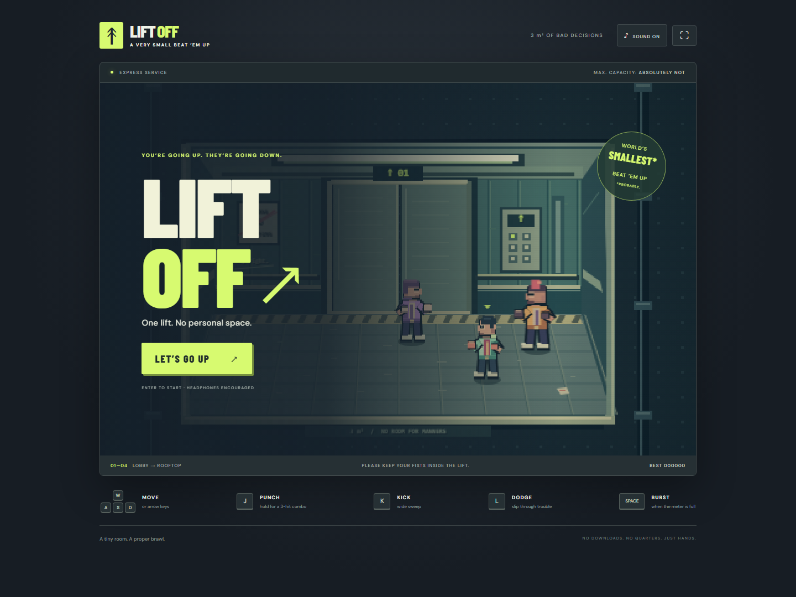

# LIFT OFF ↗

**One lift. No personal space.** A tiny 2.5D arcade beat ’em up set inside a three-square-metre elevator. Four stops, thirteen uninvited guests, one very angry building manager.

**[Play in your browser](https://mattias800.github.io/lift-off/)** · **[Download the offline game](https://github.com/mattias800/lift-off/releases/latest)**



## Play

Fight your way from the lobby to the rooftop. Move both sideways and into/out of the scene to line up your attacks. Red floor markings telegraph incoming strikes. Clear a stop to recover 22 health.

| Action | Keyboard | Standard controller |
| --- | --- | --- |
| Move | WASD / arrow keys | Left stick / D-pad |
| Punch combo | Hold J | X / west face button |
| Sweeping kick | K | A / south face button |
| Dodge | L + a direction | B / east face button |
| Burst | Space, with a full meter | Y / north face button |
| Start / pause | Enter / Esc or P | Start |
| Sound / fullscreen | M / F | On-screen buttons |

Phones and tablets have multitouch controls. Keyboard play works best on desktop. Sound starts after your first interaction; headphones encouraged.

- **Jab → cross → uppercut:** the third punch launches enemies. Knock them into a wall for extra damage.
- **Kick:** a wider sweep catches several guests at once.
- **Dodge:** briefly makes you invulnerable. With no direction held, you dodge forward.
- **Burst:** hits all around you and breaks armor. You start with one; landing hits and taking damage recharge it.
- **Heavies:** resist light hits while winding up. A kick or finisher interrupts them.
- **The manager:** resists light hits and kicks while committed to an attack. Interrupt with an uppercut or burst, or dodge the ground slam. He gets quicker below half health.

There are no accounts, network calls, downloads, or external asset requests during play. Your best score is stored locally when storage is available. The game pauses when its window loses focus.

## Run and build

Requires Node.js 24+ and npm.

```sh
npm ci
npm run dev
```

Open the local URL printed by Vite. To create the distributable:

```sh
npm run build
```

Open **`dist/index.html` directly** to play offline. JavaScript, styles, artwork, sound synthesis, and fonts are bundled into this one file. The GitHub release calls the same file `lift-off.html`.

## Verify

```sh
npm test
npm run build
npx playwright install chromium
npm run test:browser
```

Simulation tests cover hit direction/depth, the punch chain, crowd attacks, dodge, armor, wall damage, defeat, floor progression, and a complete victory using normal controls. Browser checks exercise the actual production file using keyboard and touch input, then play all four stops, verify the victory/replay flow, and check the saved score. Screenshots are written to `test-results/`. CI runs the same checks before deploying to GitHub Pages.

## Code map

The game uses TypeScript, Canvas 2D, and Web Audio. Vite is only the development/build tool; there is no runtime framework or game-engine dependency.

| File | Responsibility |
| --- | --- |
| `src/game.ts` | Deterministic, DOM-free simulation; actors, combat, AI, scoring, and floor progression |
| `src/render.ts` | Original pixel-art elevator, animated character poses, HUD, and transient visual effects |
| `src/input.ts` | Keyboard, multitouch, and standard controller input mapped to a single controls structure |
| `src/audio.ts` | Synthesized impact sounds, elevator chimes, and an adaptive musical sequencer |
| `src/main.ts` | Fixed 60 Hz loop, UI, pause, audio unlock, and local high-score storage |
| `src/style.css` | Responsive arcade cabinet and menus |

`Game.update(dt, controls)` advances the simulation. `Game.drainEvents()` returns semantic events that rendering and audio consume independently. Pass a seed to `new Game(seed)` for repeatable simulations. Movement uses a shallow ground plane; sprite height is purely visual. The presentation renders at 480 × 300 and scales with nearest-neighbor filtering.

To add a stop, extend `FLOORS` and update the four-stop UI labels. To add a combat move, extend `AttackKind`, its timing/damage definitions, and its rendered pose. Keep rules in the simulation and reactions in the presentation. A read-only `window.__LIFT_OFF__` snapshot supports browser automation without exposing a cheat interface.

## Credits and license

Game code, procedural pixel artwork, and synthesized music/effects: MIT. All game art and audio are created in code for this project.

Bundled typefaces: Barlow Condensed and DM Sans, distributed by Fontsource under the SIL Open Font License. Their complete notices are in `licenses/`. Third-party development tools retain their own licenses.
